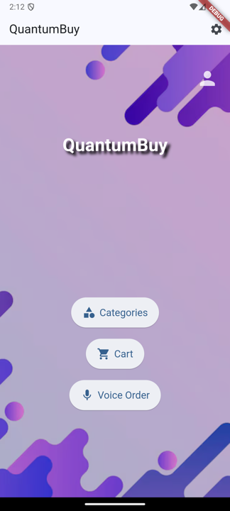
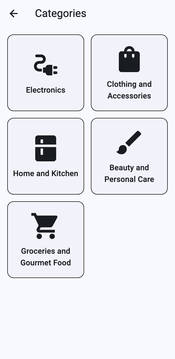
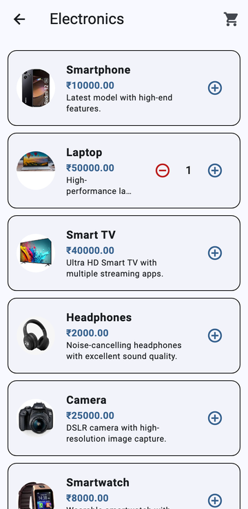
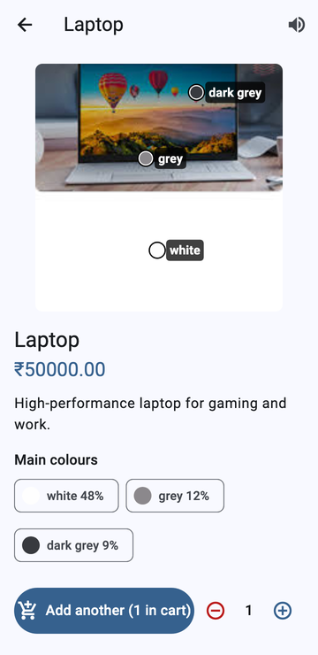
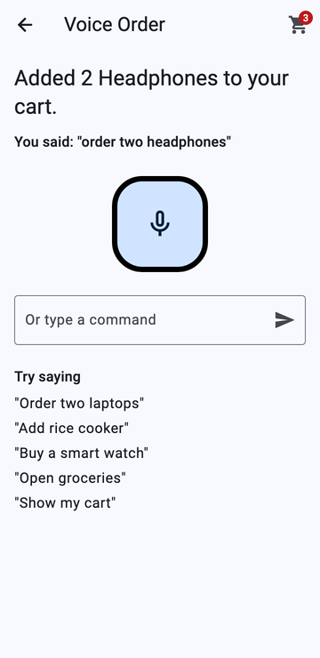

# QuantumBuy

**An accessible shopping app for people with disabilities, built with Flutter.**

QuantumBuy explores what online shopping looks like when accessibility comes first: voice
ordering, spoken feedback, larger text and dark mode, and help identifying product colours for
people with colour blindness. It runs on Android, iOS and the web from one Flutter codebase.

<p align="center">
  
  
  
  
  
</p>

## Features

- **Voice ordering.** Tap the microphone and say "open electronics" or "order laptop".
  Speech recognition (`speech_to_text`) navigates categories and adds items to the cart.
- **Spoken feedback.** Text-to-speech (`flutter_tts`) reads information aloud.
- **Accessibility settings.** Dark theme and large text apply across the app. High contrast,
  text scaling, image alt text, voice control and simplified text are in the settings screen;
  wiring them through every screen is in progress.
- **Visual-impairment profile.** An onboarding survey (low vision, colour blindness, complete
  blindness and more) to tailor the experience.
- **Colour help.** On a product page, the app finds the product's main colours and labels where
  they appear, for shoppers with colour blindness.
- **Shopping basics.** Categories (electronics, clothing, home and kitchen, beauty, groceries),
  product details, cart, checkout (UPI, card, net banking), profile, and local sign-up and login.

## Why

Accessibility research by Fable found that many disabled shoppers regularly give up on purchases
because of accessibility barriers, and many will switch to a more accessible store even when it
isn't the cheapest. QuantumBuy is a prototype of a store designed around those needs from the start.

## Getting started

Needs [Flutter](https://docs.flutter.dev/get-started/install) 3.24 or later.

```bash
flutter pub get
flutter run            # on a connected phone, an emulator, or: flutter run -d chrome
flutter test
```

## Security

Accounts are local to the device. Passwords are never stored: the app keeps only a salted
PBKDF2-HMAC-SHA256 hash (10,000 iterations), compared in constant time. Data saved by older
versions, which stored the password in plain text, is converted and the plain text deleted on
first launch (`lib/user_model.dart`, tested in `test/user_model_test.dart`).

Checkout is a demo: no payment is processed and card details aren't sent anywhere.

## Project structure

```
lib/
  main.dart                    app, theme (dark mode / large text), routes
  home_screen.dart             home: categories, cart, voice order
  categories_screen.dart       category grid
  product_list_screen.dart     products in a category
  product_detail_screen.dart   product page + colour analysis
  voice_order_screen.dart      speech commands
  cart_screen.dart, checkout_screen.dart
  settings_screen.dart         accessibility settings
  impairment_screen.dart       visual-impairment survey
  avatar_screen.dart           animated 3-D avatar
  login_screen.dart, registration_screen.dart, profile_screen.dart, edit_profile_screen.dart
  user_model.dart, cart_model.dart, settings_model.dart, product_model.dart
test/                          unit tests
assets/                        product images, 3-D model
```

## License

[MIT](LICENSE)
